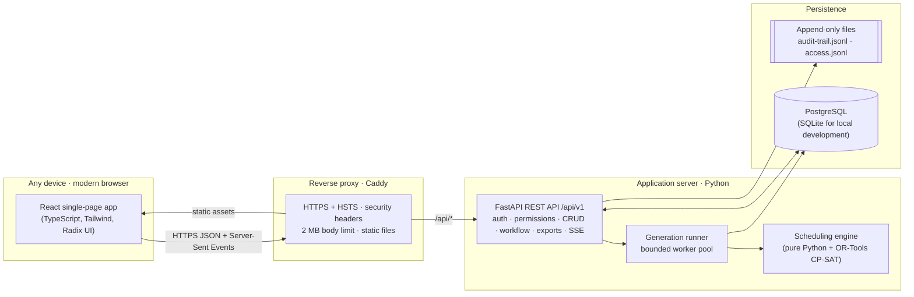
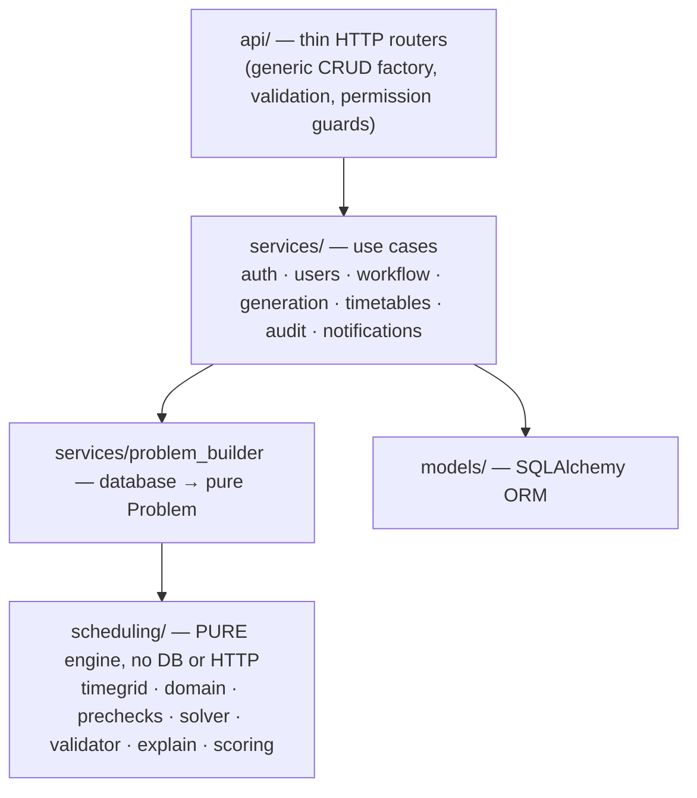
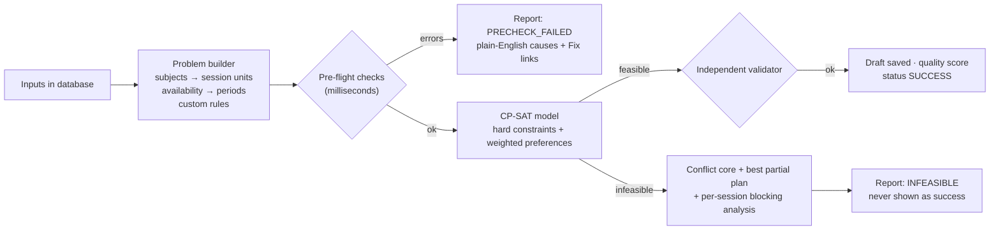
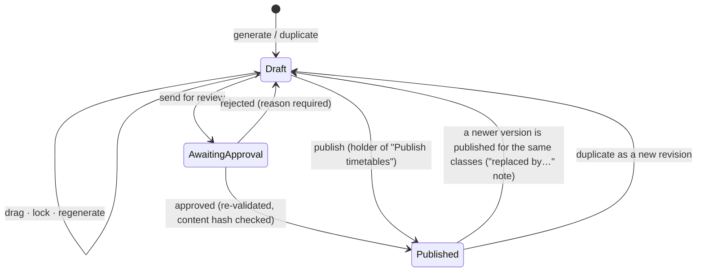
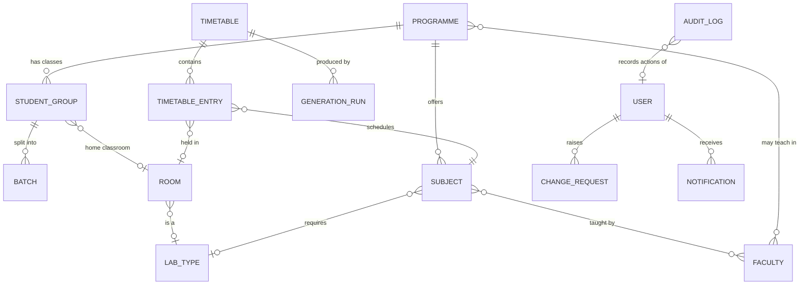

# 01 · Architecture & Technology

**Automated Academic Timetable Generation System**
National Forensic Sciences University (NFSU) · Problem Statement #1

This document explains the problem, the solution, the overall architecture, and every major technology choice, including why each one was chosen over its alternatives.

| Document | Covers |
|---|---|
| **01 · Architecture & Technology** (this file) | Problem, solution, architecture, scheduling engine, technology stack and rationale |
| 02 · User Guide & Role Flows | Every screen, and what each role does, step by step |
| 03 · Security & Consistency | Threat model, every security control, data-integrity guarantees, verification |

---

## 1. The problem

A timetable coordinator must turn the following inputs into a weekly timetable that breaks no rule:

- **University timings:** working days, start/end time, period length, breaks.
- **Rooms and laboratories:** type, capacity, availability.
- **Programmes:** semesters, class sections, student strength, practical batches.
- **Subjects:** theory or practical, weekly periods/sessions, consecutive periods, required lab type, assigned faculty.
- **Faculty constraints:** available days/times, unavailable slots, fixed commitments.
- **Additional constraints:** fixed sessions, daily teaching limits, and *preferences* that should be met where possible.

**Mandatory rules** that must never be broken:

| # | Rule |
|---|---|
| H1 | Sessions fall within working hours and avoid breaks |
| H2 | Faculty teach only when available |
| H3 | No faculty member, room or student group has overlapping sessions |
| H4 | A whole-class session never overlaps a practical of any of that class's batches |
| H5 | Room capacity ≥ class or batch strength |
| H6 | Practicals use a suitable laboratory and occupy the required consecutive periods |
| H7 | Every subject receives all its weekly theory periods and practical sessions |
| H8 | Fixed teaching commitments stay in their assigned slots |

If the requirements cannot be met, the system must **say why** (e.g. *"Subject X requires three weekly periods, but its assigned faculty member is available for only two"*) instead of presenting an incomplete timetable as a success.

The coordinator must also be able to:
- view timetables **programme-wise, faculty-wise and room-wise**;
- adjust sessions manually, with **immediate conflict validation**;
- **lock** sessions and regenerate the rest;
- save **drafts**, **publish** a validated timetable, and **print/export** it.

---

## 2. The solution at a glance

A secure web application where coordinators enter resources and rules, and an **optimisation engine** builds the best clash-free timetable. People then review, adjust, approve and publish it, and every user sees the part that concerns them.

| Capability | What the system does |
|---|---|
| **Provably correct scheduling** | Google OR-Tools **CP-SAT** finds a timetable that satisfies every mandatory rule, or *proves* that none exists. |
| **Explains impossibility** | Three layers of diagnostics: input checks → counting "pre-flight" checks → solver-level conflict analysis. Plain-English messages with a **Fix →** link to the exact record. |
| **Optimises preferences** | Spreads subjects across the week, honours preferred slots, keeps lectures in each class's home classroom, avoids late periods, and minimises changes when regenerating. Reports a 0–100 quality score. |
| **Independent verification** | A separate validator re-checks every rule after solving, on every manual edit, and before publishing. |
| **Interactive editing** | Drag and drop with a live green/amber/red map of where a session may go. Refusals name the clashing subject, teacher, class and room and suggest free slots. Lock and regenerate. |
| **Governed workflow** | Draft → (awaiting approval) → Published, with approvals (maker–checker) and notifications. One live version per class: publishing a new version returns the previous one to Draft with a "replaced by…" note. |
| **Configurable access** | Four roles (Admin › Coordinator › Faculty › Student), 22 permissions configurable per role, with hierarchical delegation and least-privilege defaults (a student sees only their own class). |
| **Accountability** | Append-only, hash-chained, verifiable audit trail, mirrored to a file outside the database. |
| **Exports** | Print layout, PDF, Excel, CSV and iCalendar (.ics). |
| **Custom rules** | Safe templates: keep a class free at certain times, restrict a subject to time windows, limit back-to-back teaching, reserve rooms for programmes. |

**Demonstration dataset:** the real Semester I 2026-27 structure of the School of Cyber Security & Digital Forensics, Gandhinagar campus:
- 4 programmes, 19 faculty, 39 subject components, 12 rooms;
- a 10:30–17:30 day with a lunch break.

**Result:** 85 weekly sessions scheduled with zero conflicts and **proven optimal** in about 9 seconds.

---

## 3. System architecture

### 3.1 Deployment view



### 3.2 Backend layers



The scheduling engine has **no database or web code**. It takes a `Problem` and returns a `Solution` or a `Diagnosis`. That makes it fast to test, reusable, and replaceable.

### 3.3 Generation pipeline



### 3.4 Timetable lifecycle



### 3.5 Core data model



Other tables: calendar settings and breaks, constraint settings, custom rules, fixed sessions, sessions (server-side login sessions), one-time codes, system settings (including the role-permission matrix), and the audit chain head.

---

## 4. The scheduling engine

### 4.1 Session units and "audience atoms"

Subjects are expanded into **session units**: one unit per theory period, and one unit per practical session per batch (of L consecutive periods).

A class is represented by **atoms**: its batches, or the class itself if it has no batches.
- A whole-class lecture uses *all* atoms.
- A batch practical uses only its own atom.

A single rule, "each atom is used by at most one session per period", gives both required behaviours:
- lectures never overlap any batch's practical (H4);
- different batches can still run practicals in parallel.

### 4.2 CP-SAT model

| Element | Formulation |
|---|---|
| **Variables** | `x[unit, day, start, room] ∈ {0,1}`, created **only** for feasible combinations: faculty available for every covered period, periods contiguous (no break), room suitable, large enough and free, custom rules satisfied. Domain filtering removes most of the search space before solving. |
| **Every session placed (H7)** | `Σ x[unit,·,·,·] = 1` |
| **No overlaps (H3/H4)** | At most one variable covering each (faculty, period), (room, period) and (atom, period) |
| **Limits** | Faculty and class daily limits, faculty weekly limit, maximum consecutive periods (custom rule) |
| **Fixed and locked sessions (H8)** | Domain restricted to the pinned slot (and room) |
| **Preferences (objective)** | Weighted penalties: subject spread across days, preferred faculty slots, last period of the day, home classroom, subject time windows (soft), stability when regenerating |
| **Symmetry breaking** | Interchangeable units of the same subject and class are ordered, which greatly reduces search |

CP-SAT combines constraint propagation, SAT-style conflict learning and parallel portfolio search. It **stops by itself when it proves the timetable optimal**. An administrator-set safety cap (default 60 s) only bounds extreme inputs.

### 4.3 When a timetable is impossible

1. **Input validation** (as you type): invalid strengths, batches larger than the class, duplicate sections, and so on.
2. **Pre-flight counting checks** (before solving), for example:
   - faculty available periods < required periods (the problem statement's own example);
   - no room large enough, no lab of the required type, no consecutive window;
   - class overloaded, lab type over-subscribed, conflicting fixed sessions;
   - nothing to schedule for the chosen term or programme (and *why*).
3. **Solver diagnosis:**
   - an assumption-based **conflict core** names the competing resource;
   - a relaxed solve produces the **best partial plan**;
   - a **blocking analysis** explains each unplaced session.

### 4.4 Interactive editing

For a dragged session, the server evaluates every cell and returns `ok`, `warning` or `blocked`, with reasons such as *"M.Sc. CS Sem 1-A already has MSCS26-PC-103-L … in BL 302, Wed 11:30–13:30"*. A refused move lists the reasons and up to three free slots, each one click away. Every accepted move is re-validated and versioned.

---

## 5. Technology stack and rationale

### 5.1 Summary

| Layer | Choice |
|---|---|
| Scheduling engine | **Google OR-Tools CP-SAT** (Python) |
| Backend | **Python 3.12 · FastAPI · Pydantic v2** |
| Persistence | **SQLAlchemy 2.0** ORM · **PostgreSQL** (production) · SQLite (local development and tests) |
| Background work | Bounded worker pool for solver runs · progress via **Server-Sent Events** |
| Frontend | **React 19 · TypeScript · Vite** single-page app |
| UI | **Tailwind CSS v4** design tokens · **Radix UI** primitives · lucide icons · **dnd-kit** drag and drop |
| Data fetching | **TanStack Query** (caching, retries, optimistic flows) · React Router |
| Security primitives | **Argon2id** (argon2-cffi) · server-side sessions · HMAC-SHA256 audit chain |
| Exports | **ReportLab** (PDF) · **openpyxl** (Excel) · csv · **icalendar** (.ics) |
| Reverse proxy | **Caddy** (automatic HTTPS, security headers) |
| Quality | pytest (25 scenario, API and security tests) · ruff · TypeScript strict mode · pip-audit · pnpm audit |

### 5.2 Why these choices

**Scheduling: OR-Tools CP-SAT**
- **Why:** timetabling is an NP-hard constraint-satisfaction and optimisation problem. CP-SAT is free (Apache-2.0), consistently among the top solvers in the international MiniZinc Challenge, multi-threaded, and supports what the problem statement needs:
  - hard constraints;
  - weighted preferences;
  - **proof of infeasibility**;
  - conflict cores, to explain failures;
  - solution hints, to keep changes small when regenerating.
- **Why not an LLM:** no guarantee that rules hold, no proof of impossibility, non-deterministic results, internet dependence, cost, and data leaving the university.
- **Why not genetic algorithms / simulated annealing:** they cannot prove impossibility, often end with violated rules, need tuning, and give different results each run.
- **Why not Timefold/OptaPlanner (Java):** excellent local search for very large problems, but it returns "best found with n violations" rather than a proof of infeasibility, and it would force a Java backend.
- **Why not MILP (CBC/Gurobi):** the open-source solvers are much slower on this kind of problem, and Gurobi needs a commercial licence.

**Backend: Python + FastAPI**
- CP-SAT's best interface is Python. One language for the API and the engine means no translation layer or extra service.
- Pydantic gives strict, declarative **input validation** at the boundary, including rejection of unknown fields.
- FastAPI generates OpenAPI documentation and supports dependency-injected permission checks.
- **Why not Node.js:** no comparable constraint solver, so it would need a Python sidecar anyway.
- **Why not Django:** heavier conventions with little benefit for a custom scheduling API.

**Database: PostgreSQL via SQLAlchemy**
- The data is highly relational (programme → class → batch; subject ↔ faculty ↔ room), so integrity needs foreign keys, unique constraints and transactions.
- JSON columns hold flexible structures such as availability ranges and rule parameters.
- Database triggers protect the audit table.
- SQLite runs the same code locally with zero setup.
- **Why not MongoDB:** relational integrity would have to be rebuilt in application code.

**Frontend: React + TypeScript + Vite (single-page app)**
- The largest ecosystem for accessible components (Radix), drag and drop (dnd-kit) and server-state caching (TanStack Query).
- TypeScript strict mode catches contract errors at build time.
- Vite produces small, code-split bundles: about 180 KB gzipped on first load, with every page loaded on demand.
- **Why not Next.js:** an authenticated internal tool has no SEO needs, and server-side rendering would add a Node server to operate and secure.
- **Why not Angular:** more boilerplate for the same result.

**Styling: Tailwind + design tokens**
- **Themes:** a CSS-variable token system gives six colour themes (NFSU default plus five), light, dark and system modes.
- **Preferences:** 12- or 24-hour time, a compact sidebar, tooltips and reduced motion, saved to the user's profile.
- **No external fonts or CDNs**, which keeps the strict Content-Security-Policy possible.

**Authentication: server-side sessions in cookies, not JWTs in browser storage**
- HttpOnly cookies can't be read by scripts, and server-side sessions can be **revoked instantly** (logout, deactivation, role downgrade, password change).
- Tokens in browser storage are exposed to script injection and can't be revoked before they expire.

**Live progress: Server-Sent Events**
- Progress flows one way, from server to browser. SSE is plain HTTP, reconnects automatically and works through proxies, with a smaller attack surface than WebSockets.

**Cross-platform**
- A responsive web app works on desktops, tablets and phones in any modern browser, with nothing to install.
- A web app manifest is included so the app can be added to a phone or desktop home screen (offline caching is on the roadmap).

---

## 6. Repository structure

```
backend/
  app/
    api/            routers (generic CRUD factory, auth, users, permissions, setup, timetables)
    core/           config, database, security, permissions, roles, errors, middleware, rate limiting
    models/         ORM models (identity, academic, timetable, workflow, audit)
    schemas/        Pydantic request/response models (strict)
    services/       use cases (auth, users, workflow, generation, timetables, audit, notifications, problem builder)
    scheduling/     pure engine: timegrid, domain, prechecks, solver, validator, explain, scoring, engine
    exports/        PDF / Excel / CSV / iCalendar renderers
    seed.py         demonstration dataset
  tests/            engine acceptance, API flow, permission, rule and security tests
  sampledata.db     ready-made sample database
frontend/
  src/
    app/            shell, routing, authentication and preference providers, navigation
    components/     UI kit (buttons, forms, overlays, tables) + shared building blocks
    features/       one folder per screen
deploy/Caddyfile    production reverse-proxy configuration
documents/          this documentation set
```

### Code reuse highlights
- **One generic CRUD factory** serves rooms, programmes, classes, faculty, subjects, fixed sessions and custom rules: one implementation of list, search, filter, paginate, validate, audit and permission checks.
- **One validator** is used by the solver post-check, manual moves, the drag map and the publish gate.
- **One resource page and one config-driven form** power every master-data screen.
- **One weekly-grid painter** serves faculty and room availability.
- **One timetable grid** renders all three views and the print layout.

---

## 7. Quality and performance

| Measure | Result |
|---|---|
| Problem statement example (M.Sc. DFIS) | All 3 theory periods and both batch practicals placed, every rule satisfied |
| Impossible-input example | Reports *"… requires 3 weekly periods, but its assigned faculty member … is available for only 2 periods"* |
| Full SCSDF dataset (85 sessions) | Zero conflicts, **proven optimal**, ≈ 9 s, quality 99.8/100 |
| Automated tests | 25 (engine acceptance, API workflow, permissions, delegation, custom rules, security behaviour) |
| Static checks | ruff (Python), TypeScript strict, production build |
| Dependency audit | pip-audit and pnpm audit: no known vulnerabilities |

---

## 8. Roadmap

- Containerised deployment (Docker Compose: proxy, API, database) and schema migrations (Alembic).
- Shared rate-limit store (Redis) and an external job queue when running several API instances.
- Authenticator-app (TOTP) multi-factor authentication for privileged accounts.
- Offline viewing of published timetables (service worker).
- Programme-scoped coordinators, combined/elective classes across sections, and exam timetabling on the same engine.
- Institutional single sign-on (OIDC/SAML) and calendar subscription links.
