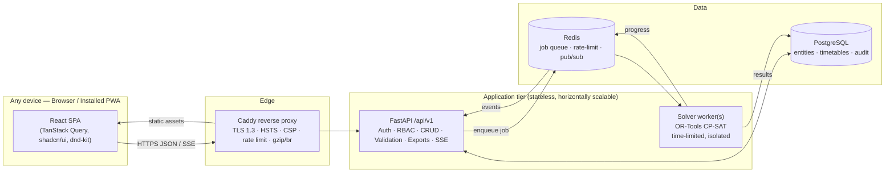

# Automated Academic Timetable Generation System
## Document 1 — Requirements Analysis, Architecture & Technology Decisions

| | |
|---|---|
| Problem | Problem Statement #1 — Automatic Creation of Academic Time Table |
| Working name | **ChronoGrid** (placeholder — rename freely) |
| Version | v1.0 (planning baseline) |
| Companion doc | `02-Implementation-Plan.md` (data model, solver, API, pages, phases) |

---

## 1. What the problem actually asks for

The timetable coordinator should be able to:

1. **Enter the inputs**: university timings, rooms and labs, programmes, groups and batches, subjects, weekly teaching load, faculty constraints, and extra constraints.
2. **Generate a timetable automatically** that meets every mandatory rule and as many preferences as possible.
3. **Get a clear explanation when it can't be done**, instead of a broken timetable that looks like a success.
4. **Review, adjust, lock and regenerate, then publish**, with three views: programme, faculty and room. Manual edits must be checked immediately. The timetable can be printed or exported.

The real value is in the hard parts: an engine that is correct, can explain failures, and supports editing and regeneration. A CRUD form app with a random or greedy filler would not meet the brief, and that is where most teams will stop. Our plan targets the hard parts directly.

---

## 2. Requirement traceability matrix

Every line in the problem statement maps to a feature and a way to check it. We will use this table as the demo checklist.

### 2.1 Coordinator inputs (Section 1)

| # | Requirement (from PS) | Our feature | Verified by |
|---|---|---|---|
| I-1 | Working days, start/end time, period duration, breaks | **Academic Calendar** page with a live preview of the period grid | Unit test: grid generation skips breaks |
| I-2 | Room number/name, type, capacity, availability | **Rooms & Labs** page, lab-type tagging, availability painter | CRUD API tests |
| I-3 | Programme, semester, section, strength, practical batches and their strengths | **Programmes** tree: Programme → Semester → Section → Batches, with a check that batch strengths add up | Validation test |
| I-4 | Subject code/name, programme+semester, theory/practical, assigned faculty | **Subjects** page; faculty can be overridden per section or batch | CRUD API tests |
| I-5 | Theory periods/week, practical sessions/week, consecutive periods per practical | Fields on Subject; the engine expands them into session units | Builder test |
| I-6 | Faculty available days/time ranges, unavailable slots, fixed commitments | **Faculty profile** with a weekly availability painter (Available / Unavailable / Preferred) and blocked commitments | Builder + solver tests |
| I-7 | Fixed sessions, required lab type, daily teaching limit | **Constraints** page: pinned sessions, lab type on practicals, per-faculty and per-group daily limits | Solver tests |
| I-8 | Distinguish **mandatory constraints** from **preferences** | Each rule is labelled *Hard* or *Soft*. Soft rules have weights (Low / Medium / High) and feed the optimisation objective | Solver tests + UI |

### 2.2 Mandatory rules (Section 2) — enforced as hard constraints in the solver and re-checked by a separate validator

| # | Mandatory rule | How it is enforced |
|---|---|---|
| H-1 | Inside working hours, avoids breaks | Sessions can only start at periods that are inside working hours and contiguous for the session's length |
| H-2 | Faculty only during available time | Start slots are filtered by faculty availability, unavailability and commitments |
| H-3 | No faculty, room or group overlap | At most one session per (faculty, slot), (room, slot) and (student group, slot) |
| H-4 | A whole-class session never overlaps a practical for any of that class's students | **Audience atoms** (§2.3 of Doc 2): a whole-class session uses every batch of the class, so it collides with any batch practical. Batches can still run practicals in parallel |
| H-5 | Room capacity ≥ class/batch strength | Candidate rooms are filtered by capacity |
| H-6 | Practicals in a suitable lab and on consecutive periods | Lab type must match; a session of length L only starts where L consecutive, break-free periods exist |
| H-7 | Every subject gets all its weekly periods and sessions | Every session unit must be scheduled exactly once. If that's impossible, the result is marked **INFEASIBLE** and never "success" |
| H-8 | Fixed commitments stay in their slots | Pinned or locked sessions are fixed to their slot before solving |

### 2.3 Impossible timetables (Section 3)

| # | Requirement | Feature |
|---|---|---|
| F-1 | Report the problem clearly and never show an incomplete timetable as successful | Run status is `SUCCESS`, `INFEASIBLE`, `PRECHECK_FAILED` or `TIMEOUT`. Only `SUCCESS` drafts can be published |
| F-2 | Messages like *"Subject DFIS103 requires three weekly periods, but its assigned faculty member is available for only two periods."* | **Three-layer diagnostics engine** (Doc 2 §3.5): input validation → pre-flight capacity checks (they produce exactly this kind of sentence) → explanation of what the solver could not place |
| F-3 | Identify unassigned sessions and the constraints involved | **Infeasibility Report** page: each problem has a severity, a plain-English sentence, the entities involved (linked), and a **"Fix →"** button that opens the right input page |

### 2.4 Review and publication (Section 4)

| # | Requirement | Feature |
|---|---|---|
| R-1 | Views by programme, faculty and room/lab | One reusable **WeekGrid** component with three view modes and a quick switcher |
| R-2 | Manual changes with immediate conflict checks | Drag and drop. While dragging, each cell shows **green / amber / red** with the reason (e.g. "Dr. Rao busy — DFIS101"). The server re-validates every move |
| R-3 | Lock sessions and regenerate the rest | A 🔒 toggle on each session. **"Regenerate unlocked"** keeps unlocked sessions close to their current slots where possible, to limit disruption |
| R-4 | Save a draft and publish a validated timetable | Versioned drafts. Publishing re-runs the full validator; previously published versions are archived; diffs between versions |
| R-5 | Print or export | Print stylesheet (A4/A3 landscape), **PDF**, **Excel**, **CSV**, and **iCalendar (.ics)** so faculty can add their schedule to Google or Outlook calendars |

### 2.5 Worked example (Section 5) — becomes an automated acceptance test

M.Sc. DFIS Sem I: 40 students in 2 batches of 20; one theory subject (3 periods/week); one practical (1 session × 2 consecutive periods per batch). Expected result: **3 theory periods + 2 batch practicals** placed, with no violations. We ship this as seed data ("Load demo data") and as test `test_ps_example_dfis.py`. A second seed variant makes the faculty available for only 2 periods, and the report must say so.

---

## 3. Ambiguities in the PS and the assumptions we chose

We record these so judges can see they were deliberate decisions. Each one can be changed in settings.

| Topic | Assumption |
|---|---|
| Period grid | All periods have the same length. A break cuts the day; periods restart after it. **A practical cannot span a break.** |
| Theory rooms | Theory runs in *classroom*-type rooms by default. A setting allows using labs for theory as a fallback. |
| Batches | Batches of the same class *may* run practicals at the same time in different labs. A whole-class session blocks all batches of that class. |
| "Fixed teaching commitments" | Two things: (a) **blocked time** outside this timetable (other department, meetings), and (b) **pinned sessions** inside this timetable. Both are supported. |
| Faculty per session | One or more faculty (practicals often need two). All of them must be free. |
| Spreading theory | Default **soft** preference: at most 1 period of the same subject per day per class. Can be made hard. |
| Daily limit | Max teaching periods per day per faculty, and optionally per class. Both **hard** when set. |
| Combined lectures / electives across sections | Not required by the PS. The data model leaves room for it (Doc 2, future work). |

---

## 4. What sets us apart from other teams

1. **A real constraint solver, not a heuristic.** Google OR-Tools CP-SAT either *proves* a timetable satisfies every hard rule or *proves* none exists. Genetic algorithms, greedy fill and random restarts can do neither.
2. **Explanations a coordinator can act on.** Plain-English problems, each linked to the input that causes it, with a one-click way to fix it.
3. **Drag-and-drop editing with a live feasibility heatmap.** The coordinator sees every legal slot for a session before dropping it.
4. **Lock and regenerate with minimal disruption.** The objective rewards keeping sessions where they are, so a small change doesn't reshuffle the whole week.
5. **Quality score.** Each draft gets a 0–100 score from the soft preferences (preferred slots met, spread, compactness), so drafts can be compared.
6. **Versioning and diff.** Draft → Published → Archived, with "what changed" between versions.
7. **Built to integrate.** Versioned REST API, OpenAPI docs, iCal feeds, Excel import/export templates, and room for SSO.
8. **Secure by design.** Mapped to OWASP Top 10 (2025), see §7.

---

## 5. Technology stack — and why

### 5.1 Summary

| Layer | Choice |
|---|---|
| Scheduling engine | **Google OR-Tools CP-SAT** (Python) |
| Backend API | **Python 3.12 + FastAPI + Pydantic v2** |
| Persistence | **PostgreSQL 16**, **SQLAlchemy 2.0** ORM, **Alembic** migrations (SQLite only for local tests) |
| Background jobs | Solver runs in a **separate worker process**. MVP: process pool with a DB-backed job table. Scale-out: **Redis + arq** behind the same interface |
| Live progress | **Server-Sent Events (SSE)** |
| Frontend | **React 19 + TypeScript + Vite** (SPA) |
| Routing / server state | **React Router**, **TanStack Query** |
| UI system | **Tailwind CSS v4 + shadcn/ui (Radix primitives)**, **lucide** icons |
| Forms / validation | **react-hook-form + zod** |
| Drag and drop | **dnd-kit** |
| API client | **Generated from OpenAPI** (`openapi-typescript` + `openapi-fetch`), so types are shared end to end |
| Cross-platform | Responsive layout + **PWA** (installable on Windows, macOS, Linux, Android, iOS; published timetables readable offline) |
| Exports | **openpyxl** (Excel), **ReportLab** (PDF, pure Python, no OS dependencies), **icalendar** (.ics), print CSS |
| Auth | Server-side sessions in **HttpOnly, Secure, SameSite cookies**, **Argon2id** password hashing, CSRF tokens, RBAC, optional **TOTP MFA** |
| Testing | **pytest** (+ **Hypothesis** property tests for the solver), **Vitest + Testing Library**, **Playwright** end-to-end |
| Quality gates | **ruff**, **mypy**, **ESLint**, **Prettier**, **pip-audit**, **pnpm audit**, Dependabot |
| Deployment | **Docker Compose**: Caddy (automatic HTTPS) → API + worker → Postgres + Redis. Non-root, read-only containers |

### 5.2 Why each choice, and why not the alternatives

#### Scheduling engine — OR-Tools CP-SAT
- **Why:** Timetabling is a known NP-hard constraint satisfaction and optimisation problem. CP-SAT is consistently among the top solvers in the MiniZinc Challenge, is free (Apache-2.0), multi-threaded, and supports what we need:
  - hard constraints, plus soft constraints as a weighted objective;
  - **proof of infeasibility** (the PS requires reporting impossible inputs honestly);
  - **assumption literals / unsat cores**, which let us name the conflicting constraints;
  - **solution hints** for "regenerate with minimal changes";
  - time limits, so a request can't hog the server.
- **Why not a genetic algorithm or simulated annealing** (what most teams will use): no guarantee of satisfying hard rules, no way to prove impossibility, needs tuning, and results are not reproducible. It fails F-1/F-2 by design.
- **Why not greedy / backtracking written by hand:** fast to write and gets stuck on real data. Also no optimisation of preferences.
- **Why not Timefold (formerly OptaPlanner, Java):** excellent for very large problems, but it is local search. It returns "best found with *n* hard violations" rather than a proof of infeasibility, and it would push the backend to Java/Kotlin, which is slower to iterate on in a hackathon. Our instance sizes (one university, a few hundred sessions) suit CP-SAT well.
- **Why not MILP (PuLP/CBC, Gurobi):** CBC is much slower on this kind of problem; Gurobi needs a commercial licence.

#### Backend — Python + FastAPI
- **Why:** CP-SAT's best API is Python. Keeping the API and the engine in **one language** avoids a separate solver microservice that only translates between languages.
- FastAPI + Pydantic v2: strict, declarative **input validation** at the edge (security), automatic **OpenAPI 3.1** docs, which we turn into a typed TypeScript client (**code reuse**), dependency injection for auth and RBAC, and high throughput (Starlette/uvicorn).
- **Why not Node.js (Express/NestJS):** no competitive constraint solver in JavaScript, so we'd need a Python sidecar anyway: two backends.
- **Why not Django + DRF:** mature, but heavier and slower to build a typed API with; its admin-centred conventions don't help a custom scheduling UI. FastAPI plus SQLAlchemy gives the same database tooling with less ceremony.
- **Why not Spring Boot:** see Timefold above. A good stack, but slower to build in for a hackathon.

#### Database — PostgreSQL
- **Why:** The data is very **relational** (programme → group → batch, subject ↔ faculty ↔ room). Integrity matters: foreign keys, unique constraints (no duplicate room codes) and transactions. **JSONB** holds flexible pieces such as availability matrices and solver statistics without a schema per variant. Proven at scale, free, runs on every cloud.
- **Why not MongoDB:** we would rebuild relational integrity in application code, and our access patterns are joins.
- **Why not MySQL:** workable, but PostgreSQL has stronger JSONB, CHECK constraints and exclusion constraints, which we can use as a database-level safety net against double-booking.
- **SQLite** is used only for fast local tests. The ORM keeps the code portable.

#### Background jobs — process worker (Redis + arq later)
- **Why:** A solve takes seconds and is CPU-bound. Running it inside the request would block the API and allow a denial-of-service. A worker process isolates it, enforces a time limit, and streams progress over SSE.
- **Why SSE rather than WebSockets:** progress only flows one way (server → browser). SSE is plain HTTP, reconnects automatically, passes proxies, and has a smaller attack surface.
- **Why not Celery:** heavier to configure; arq is small and enough for this.

#### Frontend — React + TypeScript + Vite SPA
- **Why:** largest ecosystem for what we need: an accessible component kit (shadcn/Radix), mature drag and drop (dnd-kit), virtualised tables, and solid server-state caching (TanStack Query). TypeScript plus types generated from OpenAPI means a backend change breaks the frontend build, not production. Vite gives instant hot reload and small, code-split bundles.
- **Why not Next.js:** this is an authenticated internal tool with no SEO need. SSR adds a Node server to run and secure (more attack surface, more deployment). A static SPA behind Caddy/CDN is simpler, cheaper and fast after first load.
- **Why not Angular:** capable but heavier, with more boilerplate, which costs time in a hackathon.
- **Why not Vue/Svelte:** both are fine technically. React was chosen for ecosystem depth (shadcn, dnd-kit) and because most hackathon teammates know it.
- **Why shadcn/ui + Tailwind:** components are *copied into our repo*. We own and restyle them, with no heavy runtime theme. Radix gives keyboard navigation and screen-reader support for free. Dark mode and design tokens are built in. A modern look with no bloat.

#### Auth — server-side sessions in cookies (not JWT in localStorage)
- **Why:** HttpOnly cookies can't be read by JavaScript, so XSS can't steal them. Server-side sessions can be **revoked instantly** (logout, user disabled, password changed). SameSite plus a CSRF token stops cross-site requests.
- **Why not JWT in localStorage:** readable by any injected script and can't be revoked before expiry. Common in hackathon apps; a common security finding too.
- **Future:** institutional **SSO (OIDC / SAML)** through a pluggable auth provider interface.

#### Cross-platform — responsive PWA
- **Why:** one codebase works on desktop browsers, tablets and phones and can be *installed* like a native app. A service worker caches published timetables so students and faculty can view them offline.
- **Why not native apps or Electron:** several codebases (or a 100 MB+ bundle) for no extra feature. If an app store presence is needed later, the same build can be wrapped with Capacitor (mobile) or Tauri (desktop).

---

## 6. System architecture

**Backend layers (clean architecture):** `api` (routers: HTTP only) → `services` (use cases, transactions, auth checks) → `repositories` (SQLAlchemy) → `models`.
The `scheduling` package is **pure Python with no database or HTTP code**: input is a `Problem` object, output is a `Solution` or a `Diagnosis`. That makes it fast to unit-test, reusable from the CLI, tests and worker, and replaceable.

**Single source of truth for rules:** one `validator` module checks hard rules. It is used **(a)** after every solve as a safety net, **(b)** on every manual edit, **(c)** by the "where can this go?" heatmap, and **(d)** as the gate before publishing. The rules are written once and used four times.

---

## 7. Security design (OWASP Top 10 2025 mapping)

**Threat model:** internet-facing web app. Valuable assets: account credentials, integrity of the published timetable, availability during the scheduling season. Actors: anonymous attackers, authenticated low-privilege users (faculty/viewers) trying to escalate, compromised dependencies.

| OWASP 2025 | Risk for us | Controls |
|---|---|---|
| **A01 Broken Access Control** | A viewer edits or publishes a timetable; IDOR on IDs | **RBAC** (`ADMIN`, `COORDINATOR`, `FACULTY`, `VIEWER`) enforced in a FastAPI dependency on *every* route (deny by default); object-level ownership checks; faculty can only edit *their own* availability; UUIDs instead of sequential IDs; authorisation matrix tested automatically |
| **A02 Security Misconfiguration** | Debug pages, open CORS, default credentials | Production config validated at startup (refuses to start with debug on or default secrets); CORS allow-list; security headers: **CSP** (`default-src 'self'`, no inline script), **HSTS**, `X-Content-Type-Options`, `Referrer-Policy`, `Permissions-Policy`, `frame-ancestors 'none'`; OpenAPI docs disabled in production or restricted to admins |
| **A03 Software Supply Chain Failures** | Malicious or compromised packages | Lockfiles (`uv.lock`/`requirements.txt` with **hashes**, `pnpm-lock.yaml`); `pip-audit` + `pnpm audit` in CI; Dependabot; minimal dependency list; pinned container base images; SBOM generation |
| **A04 Cryptographic Failures** | Password theft, plaintext transport | **Argon2id** (memory-hard) for passwords; TLS everywhere (Caddy automatic certificates); session tokens with 256-bit entropy stored **hashed** in the DB; secrets only from environment or secret store, never in git |
| **A05 Injection** | SQL injection, XSS, CSV/Excel formula injection | ORM with bound parameters only (no string-built SQL); Pydantic **strict** schemas with `extra="forbid"` (also blocks mass assignment); React auto-escaping, `dangerouslySetInnerHTML` banned by lint rule, plus CSP; exported cells starting with `= + - @` are escaped |
| **A06 Insecure Design** | Solver as a DoS vector; publishing an invalid timetable | Solver jobs: hard time limit, memory limit, **one active job per user/department**, queued; publish gate re-runs the validator; optimistic concurrency (version numbers) so two coordinators can't silently overwrite each other |
| **A07 Authentication Failures** | Brute force, credential stuffing, session fixation | Login rate limit per IP **and** per account, progressive lockout; generic error messages (no user enumeration); session ID rotated on login and privilege change; idle (30 min) and absolute (12 h) timeouts; password policy (min 12 chars, breached-password list check); optional **TOTP MFA**, mandatory for admins |
| **A08 Software / Data Integrity Failures** | Tampered imports or published data | Imported Excel/CSV: size limit, type sniffing, row limits, full schema validation; published timetables are **immutable snapshots** with a content hash; CI builds signed images |
| **A09 Logging & Alerting Failures** | Undetected abuse | Structured JSON logs with request IDs; **audit log** of every create/update/delete/publish/login (who, what, when, before/after); alerts on repeated auth failures; no secrets or PII in logs |
| **A10 Mishandling of Exceptional Conditions** | Stack traces leaking; half-written state | Global exception handlers return RFC 9457 `problem+json` without internals; every use case runs in a DB transaction (all-or-nothing); solver failures recorded as `FAILED` runs and never as partial success |

**Additional hardening:** request body size limits; pagination caps; `TrustedHostMiddleware`; containers run as non-root with a read-only filesystem and dropped capabilities; least-privilege DB role (no superuser, no DDL at runtime); daily DB backups; `security.txt`; dependency licences checked.

---

## 8. Non-functional targets

| Quality | Target |
|---|---|
| Generation speed | Typical department (≈50 faculty, 30 rooms, 300 session units) solved in **< 30 s**; demo dataset in **< 3 s** |
| API latency | p95 **< 150 ms** for CRUD; drag validation **< 50 ms** |
| Frontend | Initial JS **< 200 KB gzip** (route-level code splitting); Lighthouse **≥ 90** for performance and accessibility; optimistic UI on edits |
| Accessibility | **WCAG 2.1 AA**: full keyboard support (sessions can be moved by keyboard as well as by dragging), visible focus, colour-blind-safe status colours *plus* icons/text |
| Scalability | Stateless API (scale horizontally); solver workers scale independently; Postgres indexes on all foreign keys and lookup columns |
| Portability | Runs anywhere Docker runs; no OS-specific dependencies (ReportLab rather than WeasyPrint/GTK) |
| Maintainability | Typed end to end; ≥ 80 % backend test coverage on `scheduling` and `services`; conventional commits; ADRs for major decisions |

---

## 9. Future integrations

- **SSO:** OIDC (Google Workspace / Azure AD / Keycloak) and SAML through the auth provider interface.
- **ERP / SIS sync:** import programmes, students and faculty from the university ERP through the versioned REST API or scheduled CSV.
- **Webhooks:** `timetable.published` events for notice boards, LMS (Moodle) and mobile apps.
- **Calendar feeds:** per-faculty / per-class **iCal subscription URLs** (secret tokenised links) that update when a new version is published.
- **Notifications:** email when your timetable changes (diff-aware).
- **Exam timetabling and substitution management** can reuse the same engine and validator.
- **Multi-department / multi-campus:** tenant ID column planned in the schema from day one.
