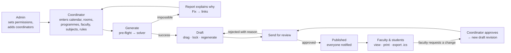

# 02 · User Guide & Role Flows

**Automated Academic Timetable Generation System**

This guide explains what every screen is for and walks through how each kind of user works with the system, with realistic examples.

---

## 1. Roles

```
ADMIN  ›  COORDINATOR  ›  FACULTY  ›  STUDENT
```

| Role | Purpose |
|---|---|
| **Admin** | Owns the system: users of every role, permissions, approvals for publishing, system settings, and the audit trail. |
| **Coordinator** | Builds the timetable: enters the academic data, generates, adjusts and sends timetables for publishing; approves faculty requests. |
| **Faculty** | Sees their teaching schedule, declares availability, requests changes, can add students. |
| **Student** | Sees and exports their class timetable. |

### Default access

Permissions are configurable per role by the Admin (see §2.17). The table shows the **defaults**. The menu shows only what a user may use, and the server enforces the same rules independently.

| Menu | Admin | Coordinator | Faculty | Student |
|---|:-:|:-:|:-:|:-:|
| Dashboard | ✅ | ✅ | ✅ | ✅ |
| Academic Calendar · Programmes · Subjects · Faculty · Classrooms & Labs · Constraints & Rules | ✅ | ✅ | | |
| Generate Timetable · Reports | ✅ | ✅ | | |
| Timetable | ✅ all, edit drafts | ✅ all, edit drafts | 👁 published: all classes, faculty & room views | 👁 published: **own class only** |
| My Availability | | | ✅ | |
| Approvals | ✅ decide | ✅ decide faculty requests | ✅ own requests | |
| Users | ✅ any role | ✅ faculty & students | ✅ students they added | |
| Audit Log | ✅ | grantable by Admin | | |
| Settings | ✅ incl. Roles & permissions, System | ✅ | ✅ | ✅ |

---

## 2. Screens

### 2.1 Frame around every page

Longer explanations are tucked behind a small **ⓘ** icon next to a title or field; hover or tap it to read them.

| Element | What it does |
|---|---|
| **Sidebar** | Main menu grouped as *Setup*, *Schedule*, *Administration*. Collapsible to icons; a slide-in menu on phones. |
| **Search pages** (`Ctrl + K`) | Type part of a page name to jump to it. |
| **Notifications** 🔔 | New users added, approval requests and decisions, published timetables, finished generations, locked accounts, permission changes. Click to open the related page. |
| **Light/Dark** ☀/🌙 | Quick switch; more options in Settings. |
| **Account menu** | Profile and Sign out. |
| **Tooltips** | Every icon-only button explains itself on hover (can be turned off). |

### 2.2 Sign in
- Email or username with a password, or **sign in with a 6-digit email code** (valid 5 minutes).
- *Remember me* keeps you signed in on that device for up to 7 days.
- After a temporary password (new account or reset), you must choose your own password before anything else opens.

### 2.3 Dashboard
- **Counters:** programmes (and class sections), subjects, faculty, classrooms and labs.
- **Recent activity** (for setup users).
- **Timetable overview** (for people who build or review timetables): choose any published timetable or draft from the drop-down. The donut chart shows the share of sessions scheduled vs unassigned, alongside sessions, quality score (/100) and room use, plus *Open this timetable*.
- **Last generation · Pending approvals · Active users** (for people who manage them).
- Students and view-only faculty see a simple **Your timetable** card instead. Scheduling statistics mean nothing to them, so they are not shown.

### 2.4 Academic Calendar
- Working days, day start/end, period length and breaks. These apply to every timetable.
- **Live preview** shows exactly the periods the generator will use (6 per day in the sample data: 10:30–13:30 and 14:30–17:30, lunch in between). A practical never runs across a break.
- The academic year and Odd/Even term are chosen per timetable, at generation time.

### 2.5 Programmes
- Programme code, name, level, school, **total semesters** (the programme's length, not the current semester), and programme coordinator (set by the Admin).
- **Class sections & lab batches:**
  - A **class** is a group of students who attend lectures together: *programme · semester · section · number of students* (1–500).
  - **Home classroom** is the room printed as "Venue" on the class timetable; lectures go there whenever it is free.
  - **Lab batches** (e.g. B1 = 20, B2 = 20) if labs are taken in smaller groups; without batches, labs are for the whole class.
  - Impossible values are refused as you type: a batch larger than the class, duplicate batch names, a second identical section.

### 2.6 Subjects
- Choose the **programme first**; the semester list and the faculty list adapt to it.
- Every subject has a **code** (e.g. `MTAI26-PC-103`), a full **name**, and a required **short name** (e.g. *VAPT*, *RM*, *EM-1*; up to 16 characters), entered separately: the abbreviation printed on timetables.
- **Theory:** periods per week. **Practical/lab:** sessions per week × consecutive periods, plus the required lab type.
- **Assigned faculty:** only people allowed to teach in that programme are offered.
- Courses taught by two people can be split into components that keep the official code with a suffix (`-L` for a 2-hour lab block, `-T2` for a second lecturer's share).

### 2.7 Faculty
- Code (timetable initials), name, designation, email, school.
- **Can teach in programmes:** limits which programmes' subjects may be assigned. Empty means any programme.
- **Max periods per day/week:** blank uses the university default, which is shown next to the field and set in *Constraints & Rules*.
- **Weekly availability** opens in view mode. *Edit availability* turns on the brushes:
  - 🟩 available, ⭐ preferred, 🟥 unavailable;
  - 🟦 marks fixed commitments (blocked time outside this timetable, e.g. a committee). These are only shown, and only explained in the legend, when a teacher actually has one; they cannot be painted over.
  - Then *Save* or *Cancel*.

### 2.8 Classrooms & Labs
- Code, name, type (classroom, or laboratory with a lab type), seating capacity, building.
- *Available for scheduling*: switch off for a room under renovation.
- **Availability** (view mode → *Edit availability*) to block periods (maintenance, examinations).

### 2.9 Constraints & Rules
- **Built-in rules** by tab (Faculty · Rooms · Subjects · Global), each **Hard** (must), **Soft** (prefer: Low/Medium/High) or **Off**:
  - faculty maximum periods per day (default 5);
  - honour preferred slots;
  - allow lectures in labs when classrooms are busy;
  - one period of a subject per day;
  - avoid the last period;
  - class maximum periods per day;
  - keep sessions in place when regenerating.
- **Custom rules** (*Add rule*), built from safe templates and shown afterwards as plain sentences:

  | Template | Example |
  |---|---|
  | Keep a class free at certain times | M.Sc. CS Sem I — Library / Project, Friday 2:30–5:30 PM |
  | Schedule a subject only at certain times | Physics Lab only in the afternoons (Must or Prefer) |
  | Limit back-to-back teaching | No faculty member teaches more than 3 periods in a row |
  | Reserve a room for some programmes | A research lab only for two named programmes |

- **Fixed sessions:** pin a session to a day and period. The form cascades programme → class → that class's subjects → batch → suitable rooms.
- **Always enforced:** the eight mandatory rules, which cannot be switched off.

### 2.10 Generate Timetable
A four-step wizard:
1. **Select settings**
   - Create a new draft or regenerate an existing one.
   - For a new draft: **academic year** and **term** (Odd = Semesters I, III, V…; Even = II, IV, VI…). The name is filled in, and a duplicate name is offered as "Name (2)".
   - Optional programme or semester filter (keeping "All" avoids clashes between programmes that share staff and rooms).
   - Mode: *Auto* (build from scratch, keeping locked sessions) or *Keep current layout* (move as little as possible).
   - There is no time setting: the engine stops on its own once it has proven the best timetable.
2. **Review:** counts (sessions, classes, faculty, periods/week) and a pre-flight result.
   - Either ✅ *All checks passed*, or plain-English problems with **Fix →**.
   - Example: *"No class sections match the even term. Existing classes — MTECH-AIDS: Sem I … Add a class under Programmes → Class sections, or choose the other term."*
3. **Generate:** live progress (solutions found, sessions placed, time) with *Cancel*.
4. **Results:** opens the Generation Report.

### 2.11 Generation Report
- A banner that never claims success unless every rule holds.
- Cards: total, scheduled, unassigned, conflicts (verified by the independent validator).
- **Summary:** quality score, "Proven optimal", solve time, and how well each preference was honoured.
- **Diagnostics:** every problem with **Fix →**.
- **Unassigned sessions:** why each could not be placed.
- *View timetable* · *Regenerate* · download PDF/Excel.

### 2.12 Timetable
- **Views:** Programme (a class) · Faculty (a teacher) · Room/Lab (a room).
- **Filters:**
  - *Show* (All / Published / Draft / Awaiting approval, with counts) → *Timetable* → the class, teacher or room.
  - There are only two real states: **Draft** (work in progress, never visible to students) and **Published** (the live timetable). "Awaiting approval" is a draft that has been sent for review. When a new version is published for the same classes, the previous one goes back to **Draft** with a note saying what replaced it.
  - **Least privilege:** students see only their own class by default. *View all classes*, *Faculty view* and *Room / Lab view* are separate permissions the Admin can grant; faculty always see their own teaching.
  - Only classes, teachers and rooms that appear in the chosen timetable are offered.
  - Each view remembers its own selection when you switch tabs.
- **The grid:** days across, periods down, breaks as bands. Each block shows the subject's **short name** in large type, its code underneath, then the room and teacher. Each colour is a subject; a dashed border marks a practical; B1/B2 tags mark batches.
- **Editing drafts:**
  - Drag a session: cells turn 🟩 allowed, 🟨 allowed but less preferred, or 🟥 not allowed (hover for the reason).
  - A refused move opens a dialog naming exactly what is in the way, for example *"Ms. X is already teaching MTAI26-SE-101 … in IFS 311"* (shown here with a placeholder name), with up to three **free slots** you can move to in one click.
  - 🔒 Lock a session; *Lock all / Unlock all visible*; **Regenerate unlocked** rebuilds the rest around locked sessions.
  - 🛡 **Check all rules** runs the independent validator.
- **Print** (clean A4 landscape) and **Export**: PDF, Excel, CSV, calendar (.ics); Excel for all classes.
- **Publish / Send for review** for drafts; *Duplicate as new draft* for published versions; *Delete draft*.
- Click any session for details. Faculty can **Request change** on a published timetable.
- The quality score and "placed" counts next to the filters are shown only to people with *View drafts & reports*.

### 2.13 My Availability (faculty)
Your own weekly availability. *Edit availability* → paint → **Send for approval** with a reason. If the Admin allows faculty to change their own availability directly, it saves immediately instead.

### 2.14 Reports
Faculty workload (periods per week) and room utilisation (% of weekly periods used) for any timetable, with an Excel download.

### 2.15 Approvals
- **Awaiting decision:** availability changes and session-move requests (decided by holders of *Approve faculty requests*), and publish requests (decided by holders of *Publish timetables*).
- **Approve**, or **Reject** with a required reason. Nobody approves their own request.
- **My requests:** status and history; cancel a pending request.

### 2.16 Users
- Search and role filter. Status: *Active*, *Invited* (temporary password not yet changed), *Deactivated*.
- **Add user:** only roles you're allowed to create. Faculty accounts can be linked to a faculty profile; student accounts get an enrollment number, class and batch.
  - The **temporary password is shown once**.
  - Higher roles are notified automatically.
- *Reset password* (signs the user out everywhere) and *Deactivate / Reactivate*.

### 2.17 Settings
- **Appearance:** Light / Dark / System; six colour themes with a live preview.
- **Preferences:** time format (**12-hour** 2:30 PM or **24-hour** 14:30), compact sidebar, tooltips, animations. Saved to your profile.
- **Roles & permissions** (Admin, or anyone allowed to manage permissions): a matrix of 22 permissions per role.
  - You can change roles **below** yours, and only permissions **you** hold.
  - 🔒 marks permissions a role can never have.
- **System** (Admin): the solver safety cap.
- **Account:** change password.

### 2.18 Audit Log (Admin, or Coordinators if granted)
Every sign-in, change, approval, export and refused attempt, with filters. Expanding a row shows details and its chain fingerprint. **Verify integrity** proves no record was altered or removed.

### 2.19 Profile
Name, email, role, last sign-in, member since; edit your name; change password.

---

## 3. Role flows

### 3.1 The big picture



### 3.2 Admin — first day

*Example: the system administrator prepares the system for the School's Semester I timetable.*

1. **Signs in** with the initial admin account and sets a personal password.
2. **Dashboard:** the system is empty. They load the School's data, or enter it through the Setup menus.
3. **Settings → Roles & permissions:** reviews the defaults.
   - Coordinators may build and send timetables but not publish.
   - Faculty availability changes need approval.
   - They decide whether coordinators may manage faculty and student permissions, and whether coordinators may read the audit log.
4. **Users → Add user:** creates one coordinator account per programme (role *Coordinator*). The temporary password is shown once and shared privately.
5. **Programmes:** sets each programme's coordinator.
6. **Ongoing:**
   - **Approvals:** publishes timetables sent for review, or rejects them with a reason.
   - **Audit Log:** reviews activity and runs **Verify integrity**.
   - **Notifications:** watches for "Account locked" and "permissions changed".

### 3.3 Coordinator — building and publishing a timetable

*Example: the coordinator of M.Tech. AI & DS (Cyber Security) prepares the Odd-term timetable.*

1. **First sign-in** with the temporary password → sets their own password.
2. **Academic Calendar:** confirms Mon–Fri, 10:30–17:30, 60-minute periods, lunch 13:30–14:30, and checks the preview.
3. **Classrooms & Labs:** checks capacities of IFS 311, BL 302/303/304, IFS 002 and the research lab; blocks a lab booked for examinations.
4. **Programmes → M.Tech. AI & DS → Class sections:** Semester 1, Section A, 30 students, home classroom **IFS 311**, no batches.
5. **Faculty:** confirms each teacher's *Can teach in* programmes and paints known unavailability.
6. **Subjects:** for example
   - `MTAI26-PC-102` Network Security and Forensics: Theory, 3 periods/week;
   - `MTAI26-PC-102-L`: Practical, 1 × 2 periods, Computer Lab.
7. **Constraints & Rules:** adds *Keep a class free* → M.Tech. AI & DS Sem I → Friday 14:30–17:30 "Library / Project".
8. **Generate Timetable:**
   - Academic year 2026-27, **Odd term** → Next → *All pre-flight checks passed* → Generate.
   - About 9 seconds later the report shows 85/85 sessions, 0 conflicts, proven optimal.
   - *If something were impossible*, the review step would explain it, e.g. *"Subject MTAI26-PC-102 requires 3 weekly periods, but its assigned faculty member is available for only 2 periods"*, and **Fix →** would open that faculty member's availability.
9. **Timetable:**
   - checks the Programme, Faculty and Room views;
   - drags a lecture to a green cell;
   - tries a red cell and reads which class and room are in the way, then uses a suggested free slot;
   - locks the good sessions → **Regenerate unlocked**;
   - **Check all rules**.
10. **Send for review** with a note. Status becomes *Awaiting approval*, editing pauses, and the Admin is notified.
11. **Notification:** *Request approved* → the timetable is **Published**, the previous version returns to Draft with a "replaced by…" note, and faculty and students are notified.
    - If rejected, the draft returns with the reason shown in red.
12. **Later:**
    - **Approvals:** decides faculty availability changes and session-move requests.
    - **Users:** adds faculty and students.
    - **Reports:** checks workload and room use.

### 3.4 Faculty — seeing and influencing a schedule

*Example: a faculty member who teaches Network Security and Forensics.*

1. Receives an account from the coordinator → **signs in** → sets a personal password.
2. **Dashboard → Open my timetable:** Timetable opens in **Faculty view** showing their sessions across all classes. They choose **Export → Calendar (.ics)** to get weekly reminders in their calendar app.
3. **My Availability:** has an external commitment every Tuesday morning.
   - **Edit availability**, paints Tuesday 10:30–13:30 red, writes the reason → **Send for approval**.
   - The coordinator is notified; the decision comes back as a notification.
   - Once approved, the next generation respects it.
4. **Needs a different slot for one lecture:** on the published timetable, clicks the session → **Request change** → picks Thursday, period 2, with a reason.
   - The system first confirms the new slot is clash-free, then sends the request.
   - If approved, the coordinator receives a new draft revision with the change, ready to publish.
5. **Approvals → My requests:** tracks status, or cancels a pending request.
6. **Users → Add user:** may add **students only**. Coordinators and the Admin are notified. They see only the students they added.
7. **Settings:** theme, dark mode, 12/24-hour time.

> Faculty cannot see drafts (unless granted), change other people's availability, edit timetables directly, or create staff accounts. The server refuses these even if attempted by hand, and records the attempt.

### 3.5 Student — my class timetable

*Example: a first-semester student of M.Sc. Digital Forensics and Information Security.*

1. Receives an account → **signs in** → sets a personal password.
2. **Dashboard → Open my timetable:** the class's **published** timetable with subjects, rooms, teachers and the lunch break.
3. **Export → Calendar (.ics)** for reminders on their phone, or **Print / PDF**.
4. A 🔔 notification arrives whenever a new version is published.
5. **Settings:** dark mode, colour theme, time format.

> By default students see only **their own class** in published timetables — no other classes, no faculty or room views (unless the Admin grants them), and never drafts, staff e-mail addresses, availability, user lists or the audit log.

### 3.6 What happens behind "Generate"

| Step | System | User sees |
|---|---|---|
| 1 | Reads inputs; expands subjects into session units; maps availability and rules onto periods | "Collecting inputs · 85 sessions to schedule" |
| 2 | Pre-flight counting checks | Problems with **Fix →**, or ✅ |
| 3 | CP-SAT search for the best clash-free arrangement | Live progress |
| 4 | Independent validator re-checks every mandatory rule | "Verified by independent validator" |
| 5 | Saves a draft, writes an audit record, notifies the requester | Generation Report |
| 6 | If impossible: conflict core, best partial plan, reason per unplaced session | Clear explanation, never a false "success" |

---

## 4. Glossary

| Term | Meaning |
|---|---|
| Session | One lecture period, or one practical block for a class or batch |
| Class / batch | Students who attend lectures together / a sub-group for labs |
| Home classroom | The class's usual room ("Venue"); preferred for lectures |
| Hard / Soft rule | Must never break / followed where possible |
| Lock | Keep a session in place when regenerating |
| Draft → Awaiting approval → Published | Life of a timetable (a replaced version returns to Draft) |
| Pre-flight check | Fast counting checks before solving |
| Validator | Independent checker of every mandatory rule |
| Quality score | 0–100: how well preferences were met |
| Odd / Even term | Semesters I, III, V… / II, IV, VI… |
