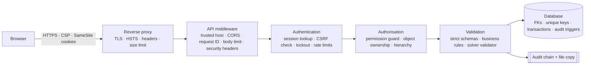

# 03 · Security & Consistency

**Automated Academic Timetable Generation System**

This document explains what the system protects, which attacks it defends against and **how**, how it keeps data consistent and timetables correct, how this was verified, and what risks remain.

---

## 1. Summary

**What needed solving.** A university timetable system is internet-facing, holds staff and student personal data, and produces an *official* document that thousands of people rely on. It must:
1. let only the right people see and change things;
2. never publish an invalid or tampered timetable;
3. leave an undeniable record of who did what;
4. stay available during the busy scheduling period.

**How it is solved.**
- Defence in depth across every layer: browser, transport, API, business rules, database and logs.
- The principle: **deny by default, validate on the server, verify independently, record everything.**

**Is it the right approach?**

| Decision | Why it fits this system | Trade-off accepted |
|---|---|---|
| Server-side sessions in HttpOnly cookies (not JWTs in browser storage) | Immune to token theft by injected scripts; sessions can be revoked instantly | Needs a database lookup per request (cheap at this scale) |
| Role-based permissions with ceilings and delegation (not per-user grants) | Predictable, auditable, scales to thousands of users; delegation follows the real hierarchy | Exceptions for individual people are handled by role changes rather than ad-hoc grants |
| Exact constraint solver + independent validator | Correctness is *proven*, and a solver bug cannot reach users | — |
| Hash-chained, append-only audit log + external file copy | Tampering is detectable even by database administrators | Detection rather than absolute prevention against someone who owns the server; mitigated by off-host copies |
| Strict schema validation at the API boundary | Removes whole classes of injection and mass-assignment bugs | Clients must send exactly the expected fields |

---

## 2. Threat model

| Asset | Threats |
|---|---|
| Accounts and sessions | Password guessing, credential stuffing, session theft or fixation, user enumeration |
| Personal data (staff e-mails, availability, student records) | Unauthorised reading, harvesting, over-exposure to low-privilege users |
| Timetable integrity | Unauthorised edits, publishing an invalid timetable, changes after approval, lost updates |
| Audit trail | Deletion or alteration to hide actions |
| Availability | Request floods, heavy solver jobs, oversized uploads |
| Users' browsers | Cross-site scripting, cross-site request forgery, clickjacking, malicious exported files |

**Attackers considered:**
- anonymous internet users and automated bots;
- signed-in users trying to exceed their role (horizontal and vertical privilege escalation);
- a curious or malicious insider with database access;
- compromised third-party packages.

---

## 3. Security controls

### 3.1 Authentication

| Control | Implementation | Prevents |
|---|---|---|
| Password hashing | **Argon2id** (time 3, memory 64 MiB, parallelism 2); old hashes re-hashed on login | Offline cracking if the database leaks |
| Password policy | ≥ 12 characters, at least 3 of lower/upper/digit/symbol, common-password list, must not contain the user's name or e-mail | Guessable passwords |
| Temporary passwords | New accounts and resets get a random one-time password; every API call except "change password", "me" and "sign out" is refused until it is changed | Shared defaults; administrators knowing users' passwords |
| Rate limiting | 10 attempts/min per IP **and** per account on sign-in and one-time-code endpoints; 5/min on password change; HTTP 429 with `Retry-After` | Brute force, credential stuffing, scripted abuse |
| Account lockout | 5 failures → 15-minute lock; Admins notified; logged as a SECURITY event | Targeted guessing |
| No user enumeration | Identical message for unknown user and wrong password; a dummy hash keeps response time equal; code requests always answer "if an account exists…" | Discovering valid accounts |
| Email one-time codes | 6 digits, stored only as a keyed hash, valid 5 minutes, 5 attempts, older codes invalidated | Code reuse or guessing |

### 3.2 Sessions

| Control | Implementation | Prevents |
|---|---|---|
| Opaque server-side sessions | 256-bit random token in an **HttpOnly, SameSite=Strict** cookie scoped to `/api`, `Secure` in production; only an HMAC of the token is stored | Session theft via XSS; using a leaked database to log in |
| Timeouts | 30 minutes idle / 12 hours absolute (7 days / 24 h idle with *Remember me*) | Abandoned sessions on shared computers |
| Fresh session per login | New identifier on every sign-in | Session fixation |
| Instant revocation | Sign-out, password change (other devices), reset, deactivation and role downgrade revoke sessions immediately | Removed users keeping access |
| CSRF protection | Every state-changing request must carry a per-session secret token (`X-CSRF-Token`) that only the application's own pages can read; compared in constant time; failures logged | Cross-site request forgery |

### 3.3 Authorisation

| Control | Implementation | Prevents |
|---|---|---|
| Permission guard on every route | Each endpoint declares the permission it needs; anything not granted is refused (deny by default) and logged as `DENIED` | Calling privileged APIs directly |
| Configurable role permissions | 22 permissions across Timetable, Setup, Requests, Users and Administration, editable per role by the Admin; permissions added later start at their safe default | Over-privileged defaults |
| Least-privilege timetable viewing | Every timetable request is checked against the requested view: a student may open only their own class; other classes need *View all classes*, other teachers need *Faculty view* (faculty always see their own teaching), rooms need *Room / Lab view*; option lists only contain what the user may open; exports follow the same rules | Students browsing other classes', teachers' or rooms' schedules |
| Ceilings | Each permission has a lowest eligible role (a Student can never publish; the audit log can go at most to Coordinators) | Mis-configuration granting dangerous rights |
| Hierarchical delegation | Holders of *Manage permissions of lower roles* may change roles **below** theirs, and only permissions **they hold**; nobody can change their own or a higher role; every change is audited and notified upward | Privilege escalation through the permission system |
| Account hierarchy | Admin → any role; Coordinator → Faculty/Student; Faculty → Student only; can't promote to own level; last active Admin protected | Creating or promoting privileged accounts |
| Object-level checks | Faculty change only their own availability, request moves only for sessions they teach, and manage only students they added; drafts invisible without *View drafts* | Insecure direct object references (IDOR) |
| Separation of duties | Nobody approves their own request; rejection requires a reason; publishing approval re-validates the timetable | One person pushing unchecked changes live |
| Data minimisation | Faculty records (e-mail, availability) need *View setup data*; others get only names that appear in a timetable they may view; faculty read their own profile through a dedicated endpoint | Harvesting staff contact details and personal schedules |
| Random identifiers | UUIDs for all records | Guessing other records' addresses |

### 3.4 Input, output and injection

| Control | Implementation | Prevents |
|---|---|---|
| Strict schemas | Types, lengths, formats (e.g. `HH:MM`), ranges (students 1–500, capacity 1–1000…); **unknown fields rejected** | Malformed data; mass assignment (e.g. sending `role: ADMIN`) |
| Business validation | Cross-entity checks (batch ≤ class, semester ≤ programme length, duplicate sections, faculty allowed in programme, lab type required for labs) | Inconsistent or impossible data |
| ORM with bound parameters | No SQL is assembled from user text | SQL injection |
| Safe rendering | React escapes all text; no raw-HTML insertion anywhere; no `eval` | Cross-site scripting |
| Content-Security-Policy | API responses and production frontend: `default-src 'self'`, `script-src 'self'` (no inline or third-party scripts), `object-src 'none'`, `frame-ancestors 'none'`; no external fonts or CDNs | Script injection, data exfiltration, clickjacking |
| Export safety | Spreadsheet cells starting with `= + - @` neutralised; text escaped before reaching the PDF engine's markup; calendar files built with a standards library; download names sanitised | CSV/formula injection; malformed or altered PDFs |
| Request limits | 2 MB maximum body; page size capped at 200 | Oversized-payload attacks |
| Custom rules as templates | Rules are typed parameters validated per template; no free-form expressions are ever evaluated | Code or logic injection through "rules" |

### 3.5 Availability

| Control | Implementation | Prevents |
|---|---|---|
| Bounded solver | Runs off the request thread in a bounded pool (2 concurrent), one active run per timetable, extra requests get "busy"; each run has a safety cap and is cancellable | CPU exhaustion through repeated generation |
| Early stop | The solver stops as soon as it proves the optimum (seconds for realistic data) | Unnecessary resource use |
| Rate limits & lockout | See §3.1 | Request floods on authentication |

### 3.6 Transport and platform hardening

| Control | Implementation |
|---|---|
| HTTPS | Reverse proxy with automatic certificates; **HSTS** (2 years, preload) |
| Security headers | `Content-Security-Policy`, `X-Frame-Options: DENY`, `X-Content-Type-Options: nosniff`, `Referrer-Policy: strict-origin-when-cross-origin`, `Permissions-Policy` (camera, microphone, geolocation, payment off), `Cross-Origin-Opener-Policy`, `Cross-Origin-Resource-Policy`, `Cache-Control: no-store` on API responses |
| Server fingerprint | `Server` header removed at the proxy; API started with `--no-server-header` |
| Host and origin checks | Trusted-host allow-list; CORS allow-list |
| Safe configuration | In production the API **refuses to start** with default or short secrets or with SQLite; secure cookies are forced, interactive API docs disabled, demonstration endpoints not mounted |
| Secrets | Loaded from environment variables or a secret store, never committed |
| Safe errors | Uniform RFC 9457 `problem+json` responses with a request ID; no stack traces or internals |
| Dependencies | Exact versions pinned (`requirements.txt`, `pnpm-lock.yaml`); `pip-audit` and `pnpm audit` report **no known vulnerabilities** |

### 3.7 Tamper-evident audit trail

**What is recorded:**
- sign-ins (success, failure, lockout), sign-outs, one-time-code requests, password changes and resets;
- user and permission changes;
- every create, update and delete of academic data (with before/after values);
- calendar and constraint changes;
- generation runs, manual moves, locks, exports;
- submissions, approvals, rejections, publications;
- every **refused** action (wrong permission, CSRF failure, self-approval attempt).

Each record holds actor, role, time, IP address, user agent and request ID. Secrets are masked automatically.

**Where it lives:** in its own table (`audit_logs`, plus a one-row chain head) within the application database.

**How it is protected:**
1. **Append-only by design:** the application has no update or delete code path for audit rows.
2. **Database triggers** reject every UPDATE, DELETE and TRUNCATE on the audit table.
3. **HMAC-SHA256 hash chain:** each record's fingerprint covers its content **and** the previous record's fingerprint. The key is kept outside the database, so even a database administrator cannot forge a consistent chain.
4. **Verify integrity:** recomputes every fingerprint and reports the first broken record, if any. The verification itself is audited.
5. **Atomic with the change:** an action and its audit record commit together or not at all.
6. **Second copy outside the database:** every committed event is appended to an append-only file (`audit-trail.jsonl`), intended to be shipped to write-once storage or a SIEM.
7. **Restricted reading:** the Admin only by default. The Admin may grant read-only access to Coordinators; Faculty and Students can never hold it. Nobody can edit or delete entries.

A separate structured access log records one line per HTTP request (method, path, status, duration, user, request ID) for monitoring.

---

## 4. Consistency and correctness

| Guarantee | How it is achieved |
|---|---|
| **No timetable breaks a mandatory rule** | Rules are enforced as hard constraints in the solver **and** re-checked by an independent validator after solving, on every manual move, and before publishing. If the two ever disagreed, the result would be marked FAILED, never success. |
| **Impossible inputs are never presented as success** | Run statuses SUCCESS / INFEASIBLE / PRECHECK_FAILED / TIMEOUT / CANCELLED / FAILED; only complete, validated drafts can be published; partial plans are clearly labelled. |
| **Published timetables are immutable** | Only drafts can be edited; a published version is changed by duplicating it into a new draft and re-publishing. |
| **One live version per class** | Publishing a new version returns any previous published version covering the same classes to Draft (with a "replaced by…" note and an audit record), so students never see two competing timetables. Nothing is deleted. |
| **What was approved is what gets published** | A content hash is recorded when a timetable is sent for review; approval is refused if anything changed since. |
| **No lost updates** | Each timetable carries a version number; a stale edit returns "Someone else changed this timetable. Reload." |
| **All-or-nothing changes** | Every use case runs in a database transaction together with its audit record. |
| **Referential integrity** | Foreign keys, unique constraints (codes, e-mails, one section per programme/semester), and cascading rules on dependent records. |
| **Stable regeneration** | Locked and fixed sessions are hard constraints; "keep current layout" minimises movement of the rest. |
| **Reproducible results** | The solver uses a fixed random seed. |

---

## 5. OWASP Top 10 (2025) mapping

| OWASP category | Main controls |
|---|---|
| A01 Broken Access Control | Permission guard on every route, ceilings, hierarchical delegation, object-level checks, separation of duties, data minimisation |
| A02 Security Misconfiguration | Production start-up validation, security headers, CORS and host allow-lists, docs and demo endpoints disabled in production |
| A03 Software Supply Chain Failures | Pinned versions, lockfiles, pip-audit and pnpm audit, no runtime CDNs |
| A04 Cryptographic Failures | Argon2id, keyed token hashes, HTTPS + HSTS, secrets from the environment |
| A05 Injection | ORM parameters, strict schemas, React escaping + CSP, formula and PDF-markup neutralisation, template-only custom rules |
| A06 Insecure Design | Maker–checker workflow, publish gate, content hash, solver resource limits, independent validator |
| A07 Authentication Failures | Rate limits, lockout, generic errors, fresh sessions, idle and absolute timeouts, temporary-password gate |
| A08 Software & Data Integrity Failures | Immutable published versions, hash-chained audit trail, transactional changes |
| A09 Logging & Alerting Failures | Comprehensive audit trail, denied-action logging, access log with request IDs, lockout and permission-change notifications |
| A10 Mishandling of Exceptional Conditions | Uniform safe errors, failed runs never reported as success, transactions roll back cleanly |

---

## 6. Attack → defence quick reference

| Attack | Stopped by |
|---|---|
| Password guessing / credential stuffing | Rate limits, lockout, Argon2id, password policy |
| Session theft through XSS | HttpOnly cookies, CSP, React escaping |
| Session fixation | New session on every login |
| CSRF | Per-session token header + SameSite=Strict |
| Clickjacking | `frame-ancestors 'none'`, `X-Frame-Options: DENY` |
| SQL injection | ORM bound parameters |
| Mass assignment | Unknown fields rejected |
| IDOR / horizontal escalation | Object ownership checks, UUIDs |
| Vertical escalation | Permission ceilings, hierarchy rules, delegation limited to own permissions |
| CSV / formula injection | Cell neutralisation |
| Malicious markup in exports | Escaping before PDF rendering |
| Staff-data harvesting | Data minimisation for low-privilege roles |
| Tampering with history | Append-only triggers, HMAC chain, external copy, verify |
| Publishing an invalid or altered timetable | Validator gate, content hash, immutable published versions |
| Request floods / heavy jobs | Rate limits, body limit, bounded solver pool, safety cap |
| Bot sign-up / account creation | No public registration; only authorised roles create accounts |
| Information leakage | Generic errors, no server banner, no stack traces |

---

## 7. Verification

Automated tests (25) include these security and consistency checks:

| Test | Proves |
|---|---|
| `test_unauthenticated_and_csrf` | Anonymous access refused; missing CSRF token refused; unknown fields refused |
| `test_security_headers` | CSP, frame protection and no-store headers present |
| `test_bad_login_is_generic` | Unknown-user and wrong-password responses are identical |
| `test_user_hierarchy_and_notifications` | Faculty can't create coordinators; coordinators can't create admins; correct roles are notified |
| `test_permission_matrix_and_delegation` | Ceilings enforced; delegation limited to lower roles and to permissions held; changes audited |
| `test_audit_access_is_controlled_and_mirrored_to_file` | Audit log off by default for coordinators, grantable by the Admin, never to faculty; file copy written |
| `test_audit_log_is_immutable_and_verifiable` | Direct database UPDATE/DELETE on audit rows refused; chain verifies |
| `test_personal_data_minimised_for_students` | Students can't read faculty records; the timetable directory exposes names only |
| `test_student_sees_only_own_class_by_default` | Students get only their own class; other classes, faculty and room views, the whole timetable and other-class exports are refused until granted |
| `test_publishing_replaces_previous_version_without_archive` | Only one live version per class; the replaced one returns to Draft with a note; students see only the live one |
| `test_temporary_password_unlocks_nothing_else` | A temporary password gives access to nothing but changing it |
| `test_scope_errors_and_safe_pdf` | Markup in names cannot break PDFs; empty scopes are explained |
| `test_faculty_availability_needs_approval` | Faculty can't change others' availability; reviewer must give a reason to reject |
| `test_generate_edit_lock_publish` | Invalid moves refused with reasons; locks respected; self-approval refused; only published timetables visible to students |
| `test_ps_example_*`, `test_solver_level_infeasibility_is_explained` | Mandatory rules hold; impossibility is reported, never shown as success |

Static analysis (ruff, TypeScript strict) and dependency audits run alongside the tests.

---

## 8. Residual risks and recommendations

| Risk | Status / recommendation |
|---|---|
| Rate limits are per server instance | Use a shared store (Redis) when running more than one API instance |
| Account lockout can be triggered deliberately against a known account | Short (15-minute) locks and Admin alerts limit impact; consider CAPTCHA or IP reputation at the proxy |
| An attacker with full server control could drop triggers and rewrite rows | The HMAC chain (key outside the database) and the off-host file copy make this detectable; ship the file to write-once storage and keep the key in a secret manager |
| Multi-factor authentication | Email one-time codes are available; add authenticator-app (TOTP) MFA for privileged roles |
| Development mode | Local development uses SQLite and no HTTPS; production configuration is enforced at start-up |
| Operational hardening | Run containers as non-root with read-only filesystems; give the database role INSERT/SELECT only on the audit table; automate backups and dependency scanning in CI |
